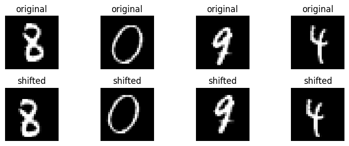
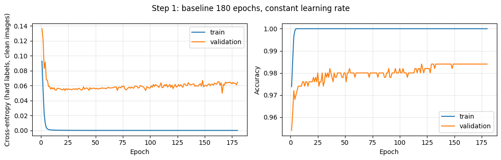
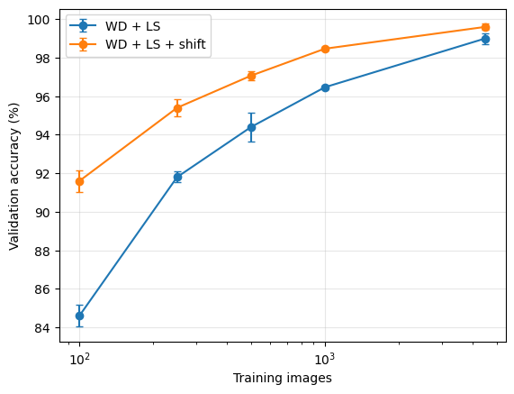
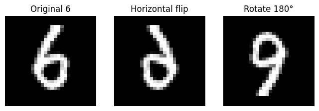

# Learning from Little Data — MNIST CNN

**Tác giả: Lê Hải Bình** · Homework 1, Deep Learning for Computer Vision

> Một CNN học từ **4.500 ảnh có nhãn** đạt **99,1985% accuracy trên 65.000 ảnh test** trong split của bài tập. Repo trình bày cách so sánh regularization, thay đổi head và augmentation dịch, cùng những giới hạn của kết luận này.

Đây là một bài thực nghiệm học tập, không phải đề xuất một phương pháp mới hay công bố kết quả state of the art.

## 1. Câu hỏi nghiên cứu

**Làm thế nào để CNN học từ rất ít dữ liệu mà vẫn tổng quát hóa tốt?**

Thay vì tăng dữ liệu có nhãn, bài khảo sát ba hướng:

1. **Regularization:** weight decay, label smoothing và dropout.
2. **Kiến trúc:** giữ backbone nhưng thay flatten bằng pooling 3×3 hoặc GAP.
3. **Khai thác dữ liệu:** dịch nhẹ ảnh train, rồi đo hiệu quả khi số ảnh giảm.

Nguyên tắc: dùng validation để so sánh/chọn model; chốt model trước lần đánh giá test cuối. Accuracy trên ảnh sạch là metric chính.

## 2. Kết quả chính

| Mục | Kết quả |
|---|---:|
| Train / validation / test | 4.500 / 500 / 65.000 |
| Recipe được chọn | CNN flatten + WD + LS + dịch |
| Seed / checkpoint | 0 / epoch 60 |
| Validation của model được chọn | 99,40% — 497/500 |
| **Test accuracy** | **99,1985% — 64.479/65.000** |
| Số lỗi test | 521 |
| Wilson 95% CI | [99,1269%; 99,2642%] |

**Nguồn số liệu:** output thực tế trong [notebook Colab đã chạy](notebooks/chapter_01_colab_results.ipynb), được lưu thành [JSON tóm tắt](results/colab_summary.json). Đợt chuẩn bị repo không chạy lại train hoặc test. Các con số ở đây thuộc lượt Colab này, không trộn với những pilot trên máy khác.

Khoảng tin cậy là Wilson cho tỉ lệ đúng của **một model cố định** dưới giả định lấy mẫu nhị thức; không bao gồm bất định do seed, chọn model hay distribution shift. Chỉ model cuối được test, nên repo không khẳng định mức tăng test accuracy so với một baseline chưa được test.

## 3. Cấu trúc repo

```text
.
├── README.md
├── requirements.txt
├── .gitignore
├── notebooks/
│   ├── chapter_01.ipynb                 # Train thật từ đầu; không cache
│   └── chapter_01_colab_results.ipynb   # Output Colab đã lưu để review
├── results/
│   └── colab_summary.json              # Trích xuất số liệu, không phải input cho train
└── assets/
    ├── step1_overfitting.png
    ├── learning_curve.png
    └── ...
```

Notebook chính tự tải MNIST, tự huấn luyện, tính bảng và vẽ đồ thị. **Không cần file cache** để chạy. JSON trong `results/` chỉ giúp đọc số liệu thuận tiện.

Snapshot Colab giữ output gốc, sửa phần diễn giải sai/thiếu theo chính bảng đã lưu, và đưa cờ test về `False`. Nó không được trình bày như một lượt vừa execute lại. Checkpoint gốc không có trong repo.

## 4. Dữ liệu và quy tắc chia tập

Cell data loading của đề được giữ nguyên:

1. Gộp official MNIST train 60.000 và test 10.000 thành 70.000 ảnh.
2. Với seed chia tập bằng 0, chọn 500 ảnh mỗi lớp: labelled pool 5.000 ảnh.
3. Chia stratified labelled pool: **4.500 train, 500 validation**, tương ứng 450 và 50 ảnh mỗi lớp.
4. 65.000 ảnh còn lại làm test.

Input ban đầu có shape `N × 1 × 28 × 28`, pixel trong `[0,1]`. Không dùng test để train, tạo subset, chọn hyperparameter hoặc học representation.

**Lưu ý benchmark:** đây là split riêng của bài tập, không phải protocol MNIST official 60k/10k. Không so trực tiếp điểm này với leaderboard dùng official split. Không gộp train + validation để train model cuối vì bài giới hạn 4.500 ảnh train.

## 5. Phương pháp

### 5.1. CNN backbone và classification head

| Khối | Phép tính | Output mỗi ảnh |
|---|---|---|
| Input | Ảnh xám | `1 × 28 × 28` |
| Block 1 | Conv 3×3, p=1 → BN → ReLU → MaxPool 2×2 | `32 × 14 × 14` |
| Block 2 | Conv 3×3, p=1 → BN → ReLU → MaxPool 2×2 | `64 × 7 × 7` |
| Block 3 | Conv 3×3, p=1 → BN → ReLU | `128 × 7 × 7` |
| Head chính | Flatten → Linear(6272, 10) | 10 logits |

CNN flatten có **155.850 tham số học**. Cross-entropy nhận logits trực tiếp; không thêm softmax trước loss. Model chuẩn hóa input với mean `0.1307`, std `0.3081` ở Steps 2–4. Baseline chẩn đoán Step 1 dùng mean/std tính từ train, được tách khỏi bảng so sánh chính.

### 5.2. Weight decay, label smoothing và dropout

- **AdamW weight decay = 0,05:** làm co trọng số trong cập nhật, tạo một ràng buộc mềm lên nghiệm học được.
- **Label smoothing ε = 0,1:** với 10 lớp, target lớp đúng là 0,91 và mỗi lớp còn lại 0,01; giảm áp lực phải đưa xác suất lớp đúng lên sát 1.
- **Dropout p = 0,5:** thử trước linear head, chỉ bật trong nhánh ablation tương ứng. Recipe cuối không dùng dropout.

Với logits `z`, xác suất `p = softmax(z)` và nhãn `y`:

$$
\widetilde y_k=(1-\varepsilon)\mathbf{1}[k=y]+\varepsilon/10,
\qquad
\mathcal L=-\sum_{k=0}^{9}\widetilde y_k\log p_k.
$$

Train/validation loss được báo sau epoch bằng **cross-entropy nhãn thật trên ảnh sạch**. Loss dùng để cập nhật khi smoothing bật có target khác; vì vậy CE và accuracy có thể xếp hạng các model khác nhau.

### 5.3. Augmentation dịch

Với mỗi ảnh train, lấy độc lập `dx, dy ∈ {-2,-1,0,1,2}` và dịch ảnh bằng **zero-fill**, giữ nhãn. Không xoay, scale hay shear trong đối chứng này. Không dùng `torch.roll`: roll đưa nét đi qua một mép quay lại mép đối diện.

Giả định là dịch nhỏ thường giữ nguyên chữ số và không nên đổi dự đoán. Đây là giả định có điều kiện: MNIST không luôn có lề trống đủ rộng; ảnh sát biên có thể bị cắt nét.



### 5.4. Ngân sách huấn luyện

| Mục | Step 1 | Steps 2–4 |
|---|---|---|
| Optimizer | AdamW, WD=0 | AdamW, WD theo recipe |
| Batch size | 64 | 64 |
| Epoch | 180 | 60 |
| Learning rate | Cố định 0,001 | Cosine từ 0,001 về 0 |
| Seed | 0 | 0, 1, 2 |
| Checkpoint báo cáo | Epoch cuối; theo dõi toàn đường loss | Epoch cuối |

Cosine theo epoch index `t=0,…,59`:

$$\eta_t=0.001\,\frac{1+\cos(\pi t/59)}{2}.$$

Epoch 60 có LR bằng 0; running statistics của BatchNorm vẫn có thể thay đổi khi model ở train mode. Thứ tự batch dùng RNG riêng seed `1000 + training_seed` để augmentation/dropout không làm đổi thứ tự ảnh giữa các recipe.

## 6. Experiments

Các bảng báo **mean accuracy ± population SD qua ba seed**. SD có đơn vị điểm phần trăm, không phải khoảng tin cậy; ba seed vẫn dùng cùng một split validation.

### Step 1 — Quan sát overfit

Baseline đạt 100% train accuracy trước epoch 20 và train loss giảm gần 0. Trong snapshot Colab, epoch 180 có validation accuracy **98,4%**, CE **0,06435**; CE thấp nhất ghi nhận là **0,04977 tại epoch 166**.

Đường loss cho thấy plateau và xu hướng tăng nhẹ sau giai đoạn đầu: phù hợp với overfit nhẹ, không phải accuracy sụt mạnh. Không coi điểm CE thấp nhất đơn lẻ là thời điểm bắt đầu overfit. Accuracy validation có thể tăng trong khi CE tăng nếu model trở nên tự tin hơn ở những ảnh vẫn dự đoán sai.



### Step 2 — Regularization

| Recipe | Mean ± SD | Seed 0 / 1 / 2 |
|---|---:|---|
| Baseline | 98,47% ± 0,19 | 98,2 / 98,6 / 98,6 |
| WD + LS | 99,00% ± 0,28 | 98,6 / 99,2 / 99,2 |
| WD + LS + dropout | 99,20% ± 0,16 | 99,0 / 99,2 / 99,4 |

Regularization cải thiện accuracy trong các lượt này. WD và LS được thay cùng nhau nên bảng không tách được đóng góp riêng của từng thành phần. Thêm dropout tăng mean 0,20 điểm, chưa đủ để khẳng định ưu thế tổng quát.

### Step 3 — Head ablation

Giữ width 32, không regularizer hoặc augmentation:

| Head | Tham số | Mean ± SD |
|---|---:|---:|
| Flatten | 155.850 | 98,47% ± 0,19 |
| Average pool 3×3 → flatten | 104.650 | 98,60% ± 0,28 |
| GAP | 94.410 | 96,53% ± 0,50 |

Pool 3×3 giảm khoảng 33% tham số với accuracy gần flatten. GAP thấp hơn; kết quả phù hợp với giả thuyết bố cục không gian thô hữu ích cho chữ số, nhưng không tách được ảnh hưởng của bố cục, capacity và tối ưu hóa.

Pool 3×3 dùng phép mean/stack với các bins adaptive pooling để hỗ trợ MPS. Không chạy đầy đủ head × regularization × augmentation, nên chưa biết pool 3×3 kết hợp recipe tốt nhất có hơn flatten hay không.

### Step 4 — Augmentation và so sánh ghép cặp

| Recipe | Mean ± SD | Seed 0 / 1 / 2 |
|---|---:|---|
| WD + LS | 99,00% ± 0,28 | 98,6 / 99,2 / 99,2 |
| WD + LS + dịch | **99,60% ± 0,16** | 99,4 / 99,8 / 99,6 |

Tăng mean **0,60 điểm phần trăm**, cùng chiều ở cả ba seed. Exact McNemar so trên cùng 500 ảnh:

| Seed | Chỉ model không dịch đúng | Chỉ model có dịch đúng | p hai phía |
|---:|---:|---:|---:|
| 0 | 1 | 5 | 0,21875 |
| 1 | 1 | 4 | 0,375 |
| 2 | 0 | 2 | 0,5 |

Không seed nào có p < 0,05. Hướng cải thiện nhất quán, nhưng chưa có bằng chứng mạnh theo kiểm định từng seed. Không gộp thành 1.500 mẫu độc lập vì cùng 500 ảnh lặp lại; p chưa chỉnh cho nhiều phép so sánh. p lớn cũng không chứng minh hai model tương đương.

### Learning curve — lợi ích khi dữ liệu ít

So WD + LS có/không dịch, cùng subset cân bằng và lồng nhau theo seed; validation không đổi:

| Tổng train | Không dịch | Có dịch | Tăng mean |
|---:|---:|---:|---:|
| 100 | 84,60% ± 0,57 | 91,60% ± 0,57 | +7,00 điểm |
| 250 | 91,80% ± 0,28 | 95,40% ± 0,43 | +3,60 điểm |
| 500 | 94,40% ± 0,75 | 97,07% ± 0,25 | +2,67 điểm |
| 1.000 | 96,47% ± 0,09 | 98,47% ± 0,09 | +2,00 điểm |
| 4.500 | 99,00% ± 0,28 | 99,60% ± 0,16 | +0,60 điểm |



Đây là bằng chứng trực tiếp nhất trong bài cho việc khai thác tốt hơn ít dữ liệu: lợi ích augmentation lớn hơn ở các mức train nhỏ đã khảo sát. Tuy nhiên, cùng 60 epoch không đồng nghĩa cùng số gradient update; variation ở n nhỏ gồm cả chọn subset và tối ưu hóa. Không suy ra bảo đảm sample complexity từ một learning curve.

Không dùng lật/xoay lớn như augmentation giữ nhãn: xoay 180° có thể khiến 6 giống 9; lật có thể tạo chữ số phản gương. Đây là ví dụ về biến đổi không an toàn, không phải phép hoán đổi nhãn đúng cho mọi ảnh.



### Step 5 — Chọn model và test

Chọn recipe theo **mean validation accuracy qua ba seed**, rồi dùng **seed 0 cố định**, không lấy riêng seed có validation cao nhất. Recipe thắng trong những ứng viên đã chạy là `wd_ls_shift`, checkpoint epoch 60; không train lại trên train + validation.

Kết quả test: **64.479/65.000**, accuracy **99,1985%**, Wilson 95% CI **[99,1269%; 99,2642%]**. Đây là kết quả của model cuối, không phải mean test qua ba seed hoặc ensemble.

## 7. Chạy notebook

### Xem kết quả không cần GPU

Mở [snapshot Colab](notebooks/chapter_01_colab_results.ipynb) trên GitHub hoặc Colab để đọc output đã lưu. Không cần huấn luyện lại để xem kết quả.

### Google Colab

1. Upload/mở [notebook chạy từ đầu](notebooks/chapter_01.ipynb).
2. Bật GPU trong cài đặt runtime; kiểm tra dòng `Device: cuda`.
3. Chạy lần lượt các cell. Step 1 có 180 epoch và learning curve gồm nhiều lượt, nên không phải notebook chạy tức thì.
4. Notebook tự lưu checkpoint/lịch sử vào `hw1_runs/<timestamp>/`; lưu output notebook trước khi đóng runtime.

Colab có thể mất file khi runtime kết thúc; nếu muốn giữ checkpoint, chủ động tải về hoặc chép output sang Drive. Bản notebook chính không bắt buộc mount Drive hay chuẩn bị cache.

### Máy cá nhân

Cần Python có hỗ trợ bộ PyTorch phù hợp với máy; môi trường Colab chính xác không được export nên dependency file dưới đây **không phải lockfile**.

```bash
python3 -m venv .venv
source .venv/bin/activate
python -m pip install -r requirements.txt
jupyter lab
```

Mở `notebooks/chapter_01.ipynb`. Nó tải MNIST vào `./data` của working directory hiện tại. CUDA/MPS/CPU được chọn tự động; chạy CPU có thể lâu. Seed cố định không bảo đảm bitwise reproducibility giữa CUDA, MPS, CPU hoặc phiên bản thư viện.

### Về lần test cuối

Notebook mặc định `RUN_STEP5=False`. Với một protocol mới được phép đánh giá, chỉ bật sau khi chốt bằng validation; cell tạo `HW1_TEST_STARTED.json` trước inference và ghi `HW1_TEST_RESULT.json` sau khi xong. `open('x')` chặn vô tình chạy lại trong cùng working directory.

Đối với kết quả đã công bố ở repo này, **test đã được dùng**: chạy lại để học cách huấn luyện không tạo ra một test set chưa từng xem. Không tune tiếp dựa vào 99,1985%, không xóa guard để thử model khác trên cùng test. Guard cục bộ không bảo vệ qua runtime mới, đổi thư mục hoặc xóa file; quy tắc thí nghiệm vẫn cần người chạy tuân thủ.

## 8. Hạn chế và cách đọc kết quả

1. **Một dataset, một split:** chữ số MNIST tương đối chuẩn hóa; không suy rộng trực tiếp sang ảnh tự nhiên, chữ viết ngoài MNIST hay ứng dụng thực tế.
2. **Validation nhỏ và được dùng nhiều lần:** 500 ảnh, mỗi ảnh tương ứng 0,2 điểm accuracy cho một seed. Chọn nhiều recipe trên cùng split có thể gây selection bias.
3. **Chỉ ba seed:** SD không đại diện đầy đủ bất định; cùng validation được lặp lại, không phải ba test set độc lập.
4. **Ablation chưa đầy đủ:** chưa tách riêng WD/LS ở protocol cuối, chưa thử mọi tổ hợp head × regularizer × augmentation. Chưa chứng minh recipe là tối ưu toàn cục.
5. **Ưu thế nhỏ ở full data:** +0,60 điểm validation có p McNemar chưa nhỏ ở từng seed. Learning curve cho hiệu ứng lớn hơn ở n nhỏ nhưng vẫn không phải bảo đảm lý thuyết.
6. **Augmentation có điều kiện:** dịch có thể cắt nét ở biên; không chứng minh bất biến dịch chính xác hoặc robustness với mọi biến đổi.
7. **Không có test baseline:** không báo mức tăng test accuracy của recipe cuối so với baseline.
8. **Tái lập không hoàn toàn:** có code, saved output và số liệu trích xuất; thiếu checkpoint gốc, full per-epoch JSON gốc và export môi trường Colab. Có thể train lại, nhưng không kiểm tra lại đúng trọng số đã công bố từ repo này.
9. **Không tuyên bố novelty:** thành phần sử dụng là CNN và regularization/augmentation thông dụng. Kết quả này đáp ứng bài học thực nghiệm, chưa đủ để tuyên bố phương pháp nghiên cứu mới.

## 9. Kết luận

Trong split bài tập, một CNN tiêu chuẩn kết hợp **weight decay + label smoothing + dịch nhẹ** đạt 99,1985% test accuracy từ 4.500 ảnh có nhãn. Bài học chính là xác định giả định giữ nhãn phù hợp và đo bằng đối chứng, thay vì chỉ tăng độ phức tạp kiến trúc. Learning curve cho thấy augmentation dịch đặc biệt hữu ích khi số ảnh ít.

Nếu nghiên cứu tiếp, cần đặt protocol mới trước khi thử nghiệm: thêm split/seed, kiểm soát số update và capacity, thử pool 3×3 cùng regularizer, và dùng tập đánh giá chưa bị dùng để phát triển ý tưởng. Không tiếp tục dùng điểm test hiện tại để chọn hướng.

## 10. Nguồn và ghi nhận

- [MNIST — trang dataset](https://yann.lecun.org/exdb/mnist/).
- Bài tập **Homework 1 — Learning from Little Data**, Chapter 1 của học phần Deep Learning for Computer Vision. Cell loading và đề bài được giữ theo tài liệu được giao; repo không tự nhận quyền tác giả phần này.
- Kết quả đến từ notebook Colab của tác giả, lưu trong repo. README và phần tổ chức repo được hỗ trợ bởi Jasmine; không có lượt test mới khi soạn README.
